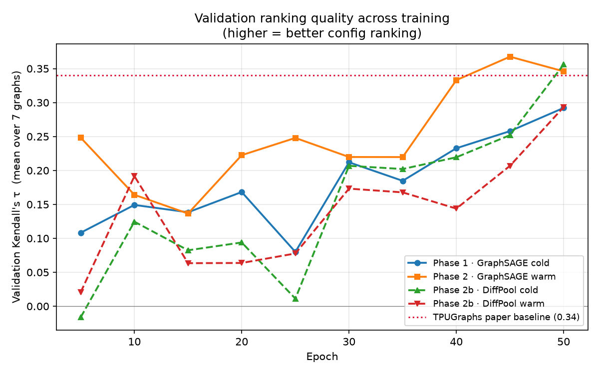
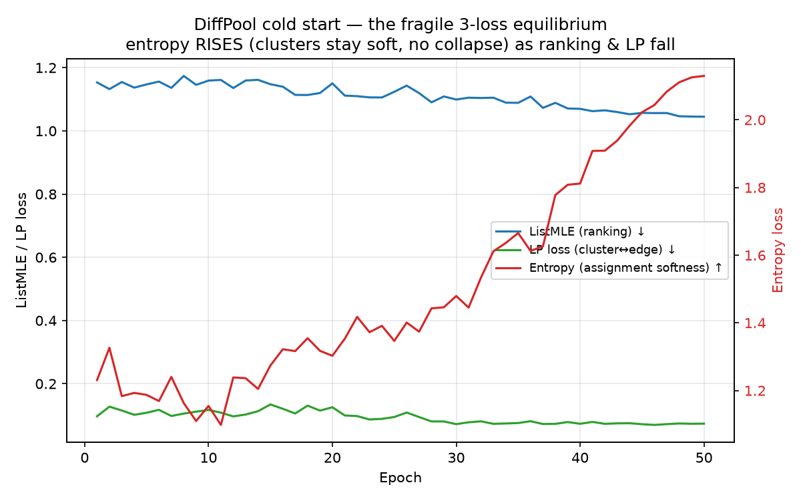

# Phase 1 & 2 Training Results
## TPUGraphs GNN Compiler Optimization — GraphSAGE + Hierarchical DiffPool

**Target:** Kendall's τ > 0.34 (paper baseline)  
**Best result:** τ = **0.3676** (GraphSAGE warm start) ✓

> 🔬 **Before citing anything here in the paper, read [`../VERIFICATION.md`](../VERIFICATION.md).**
> Several headline claims below are still AI-asserted (single-run, confounded comparison, causal
> mechanism unproven). The `⚠️ HUMAN-VERIFY` boxes inline mark exactly which, and what check each needs.

> ### ⛔ RETRACTION (2026-06-22) — the "hierarchy wins" claim did not survive its ablation.
> The Phase 2b conclusion that **DiffPool's hierarchy** caused the gain (0.3560 vs 0.2921) was
> **confounded by parameter count** (235k vs 136k). A controlled, parameter-matched, 5-seed
> ablation — [`phase2c_ablation_results.md`](phase2c_ablation_results.md) — found **no
> significant difference** between DiffPool and a same-size flat GraphSAGE
> (Δτ = −0.0117, paired t-test p = 0.22; flat is numerically *ahead*). **Treat every "proven /
> decisive / bypasses the λ₁ bottleneck" statement below as RETRACTED** and read it through the
> lens of Phase 2c. The sections are kept (not deleted) as an honest record of what we believed
> before we tested it. `VERIFICATION.md` claim C2 carries the resolution.

### Run summary (all 4 runs)

| # | Model | Init | τ | Note |
|---|-------|------|---|------|
| 1 | GraphSAGE (baseline) | cold | 0.2921 | still climbing at ep50 |
| 2 | GraphSAGE (baseline) | warm (from #1) | **0.3676** | best overall; beats paper 0.34 |
| 3 | Hierarchical DiffPool | cold | **0.3560** | ⛔ gap vs #1 is a param-count confound — see [Phase 2c](phase2c_ablation_results.md) |
| 4 | Hierarchical DiffPool | warm (from #3) | 0.2933 | regressed — LR restart broke the pooling equilibrium |



*All four runs, validation τ vs epoch (regenerate with `python scripts/plot_training_results.py`).
Note the recurring pattern: every curve makes its big jump in the last ~10 epochs, when the
learning rate drops below 1e-4. GraphSAGE-warm (orange) is the only run to clear 0.34 at its peak.*

---

## Why this project exists (read this first)

The TPU compiler (XLA) can lay out a neural network's operations in memory many
different ways. Each **layout configuration** runs at a different speed. We want a model
that, given a computation graph and a set of candidate configurations, **ranks them from
fastest to slowest** — so the compiler can pick the fast one without actually running
all of them on hardware.

Our core scientific hypothesis is about **over-squashing**. A GNN learns by passing
messages along edges; after `L` layers, each node has only "heard from" neighbors up to
`L` hops away. XLA graphs are **long and stringy** (formally: a *low spectral gap*, a
small second eigenvalue λ₁ of the graph Laplacian → a large *diameter*). Information from
a distant-but-important operation gets **squashed** into a fixed-size vector before it can
travel far enough to matter. We believe this is the main thing limiting accuracy, and the
whole project is a sequence of attempts to defeat it:
- **Phase 1** — establish a flat GraphSAGE baseline (hop-limited → expected to plateau).
- **Phase 2** — warm-start it (does more training on top of Phase 1 help?).
- **Phase 2b** — DiffPool: *coarsen* the graph to shrink its diameter so messages reach
  globally. (This is the phase that confirms the hypothesis.)
- **Phase 3** — add *shortcut edges* for hardware contention (separate document).

### Concepts primer (one-liners — skip if familiar)

| Term | What it means here |
|---|---|
| **Kendall's τ** | Our evaluation metric. A rank-correlation in [−1, 1] measuring how well our predicted ordering of configs matches the true (by-runtime) ordering. τ=1 is perfect, τ=0 is random. The TPUGraphs paper reports ~0.34; that's the bar we beat. |
| **ListMLE** | Our loss function. A *listwise ranking* loss: instead of predicting absolute runtimes, it directly optimizes the *probability of the correct ordering* of a whole list of configs. Lower loss = better-ordered. |
| **Early-Join** | How we feed config info to the model. Each config's 18 features are fused **onto the node features before** any message passing (concatenated → 158-dim input), rather than added at the end. "Early" = joined before the GNN, so config info propagates through the graph. |
| **GraphSAGE / SAGEConv** | Our GNN layer. Each node updates itself by aggregating (mean) its neighbors' vectors, then a learned linear layer. Stacking `L` of them = `L` hops of message passing. |
| **Residual connection** | `x = x + f(x)` instead of `x = f(x)`. Lets gradients flow and preserves the input signal; standard for training deeper nets. |
| **BatchNorm (`track_running_stats=False`)** | Normalizes activations per batch. The flag forces it to use *current-batch* statistics at eval time too (not stored averages) — critical here; see Bug 1. |
| **Cold vs warm start** | *Cold* = train from random weights. *Warm* = initialize from a previous run's best checkpoint, then keep training (here with a fresh learning-rate schedule). |
| **Spectral gap (λ₁) / diameter** | Graph "stringiness." Low λ₁ ⇒ large diameter ⇒ messages need many hops to cross ⇒ over-squashing. The number Phase 2b attacks. |

---

## Dataset

- **Task:** Predict fastest XLA layout configurations for TPU programs (layout:xla:random split)
- **Train:** 69 graphs, ~1,005,926 (graph, config) pairs
- **Val:** 7 graphs, 59,809 (graph, config) pairs
- **Features:** 140-dim base node features + 18-dim config features = 158-dim input (Early-Join)
- **Label:** Config runtime (lower = faster); evaluation metric is Kendall's τ

**Eval protocol (how the reported τ is computed):** for *each* of the 7 val graphs (that
has ≥2 configs), we score all of its configs, then compute
`scipy.stats.kendalltau(predicted_scores, −true_runtimes)` — the minus sign aligns "high
score" with "low runtime = fast." We then **average the per-graph τ across the 7 graphs**.
So a reported τ is a mean of 7 per-graph rank-correlations, never one global correlation
(that would wrongly compare runtimes across different models). `val_n_graphs=7` in the
logs confirms all 7 were used.

> ⚠️ **HUMAN-VERIFY (baseline comparability).** Our "beats the paper's 0.34" claim is only valid
> if our τ is computed the *same way* the TPUGraphs paper computes theirs — same split, same
> per-graph-then-averaged protocol, same handling of ties. Confirm this against the paper before
> the comparison goes in writing. Also note **7 val graphs is a very small sample** → the mean τ
> is high-variance. Final numbers should use the official held-out **test** set, not just these 7.
> See `VERIFICATION.md` claims C1/C4.

---

## Architecture

**Model:** `BaselineGraphSAGE` (`model.py`) — 136,321 parameters

```
input_proj: Linear(158 → 128)
3× SAGEConv(128 → 128) + BatchNorm1d(track_running_stats=False) + LeakyReLU(0.01) + residual
dual pool: global_mean_pool(all nodes) ‖ global_mean_pool(config nodes only) → 256-dim
MLP head: Linear(256 → 64) → ReLU → Linear(64 → 1)
```

**Key design decisions:**

| Decision | Why |
|---|---|
| `track_running_stats=False` on BN | Running stats accumulated over 69 diverse training graphs don't transfer to individual val graphs — val_τ collapses to 0 in eval mode without this |
| `dropout=0.0` | Dropout in residual branches causes 10,000× train/eval score std discrepancy (7015 vs 0.79), making the model use noise for score variation rather than learned features |
| `sign(x) * log1p(\|x\|)` on all features | Base features span [-2, 26M]; one outlier node (26M) dominates BN statistics and collapses all other node activations. Log1p compresses range to [-4.62, 17.08] |
| Dual pooling (all nodes + config nodes) | Config-specific nodes are only ~7% of graph nodes; global mean pool dilutes the config signal. Pooling config nodes separately and concatenating recovers it |
| Config features × 100 scaling | Config features (18-dim) are binary/small integers; scaling makes them comparable in magnitude to base features after log1p |
| Log1p cached on base features | Precomputing log1p on 140-dim base features in graph cache (once per graph load) instead of per-config reduces redundant computation 512× |

---

## Training Setup

| Hyperparameter | Value |
|---|---|
| Loss | ListMLE (listwise ranking) |
| Optimizer | Adam, lr=1e-3, weight_decay=1e-4 |
| LR schedule | CosineAnnealingLR, T_max=50, eta_min=1e-5 |
| Grad clip | max_norm=0.1 |
| Batch | 32 configs/batch, all from one graph (SingleGraphBatchSampler) |
| max_configs_per_graph | 512 (caps configs sampled per graph per epoch) |
| num_workers | 4 |
| Val frequency | Every 5 epochs |
| Val batch | 32 configs/forward pass |

**Why SingleGraphBatchSampler matters:** Standard DataLoader with shuffle=True mixes configs from different graphs into the same batch. ListMLE on cross-graph configs ranks AlexNet configs against BERT configs — incomparable runtimes. The model overfits cross-graph ordering and learns nothing about within-graph config quality, producing val_τ ≈ 0.

### Canonical launch commands (to reproduce / relaunch)

> We lost hours earlier to *missing* `--max-configs-per-graph` / `--num-workers` flags
> (without the cap, an epoch processes ~1M configs instead of ~35k → 4+ hour epochs).
> Always include both. These are the exact commands behind the runs in this doc.

**Phase 1 — GraphSAGE cold start** (run `s8cx8q38`):
```bash
.venv/bin/python train.py --model baseline --project tpugraphs-baseline \
    --epochs 50 --configs-per-batch 32 --max-configs-per-graph 512 --num-workers 4 \
    --lr 1e-3 --weight-decay 1e-4 --grad-clip 0.1 --dropout 0.0
```

**Phase 2 — GraphSAGE warm start** (run `5b9ryxid`): identical, plus a fresh schedule
resumed from Phase 1's checkpoint (loads weights only, resets the optimizer):
```bash
.venv/bin/python train.py --model baseline --project tpugraphs-phase2 \
    --epochs 50 --configs-per-batch 32 --max-configs-per-graph 512 --num-workers 4 \
    --lr 1e-3 --weight-decay 1e-4 --grad-clip 0.1 --dropout 0.0 \
    --resume checkpoints/best_model.pt
```

**Phase 2b — DiffPool** (cold `o1zvl1jk` / warm `fp4lcpe8`): `--model hierarchical`,
smaller batch (DiffPool is memory-heavier), and the two aux-loss weights. Add `--resume`
for the warm run:
```bash
.venv/bin/python train.py --model hierarchical --project tpugraphs-phase2 \
    --epochs 50 --configs-per-batch 8 --max-configs-per-graph 512 --num-workers 4 \
    --lp-weight 0.1 --entropy-weight 0.01
```

---

## Bugs Found and Fixed (pre-Phase 1)

### 1. BN running stats mismatch
**Symptom:** val_τ = 0 despite decreasing training loss.  
**Root cause:** `BatchNorm1d` with `track_running_stats=True` accumulates population statistics over all 69 training graphs. At inference, these stats don't match the distribution of any individual val graph, causing activations to collapse.  
**Fix:** `track_running_stats=False` — uses batch statistics at both train and eval time.

### 2. Dropout in residual branches
**Symptom:** Training score std ≈ 7015, eval score std ≈ 0.79 (10,000× gap). Model ranks all val configs nearly identically.  
**Root cause:** With dropout=0.1 in `x = x + dropout(h)`, the residual adds noise during training (std inflates scores), but at eval the noise is gone (std collapses). The model learns to use the dropout noise for score variation rather than the graph structure.  
**Fix:** `dropout=0.0`. Regularization comes from weight_decay and per-epoch config subsampling.

### 3. Feature scale explosion
**Symptom:** Loss diverged 2.5 → 90 in epoch 2.  
**Root cause:** Base features span [-2, 26M]. One node with value 26M dominated BN statistics, compressing all other nodes' normalized activations to near-zero. Residual connections compounded this by preserving the huge pre-BN values.  
**Fix:** `sign(x) * log1p(|x|)` applied to all features before training.

### 4. GPU underutilization (GPU at 3%, CPU at 88%)
**Symptom:** Data loading was the bottleneck — graph cache miss on every config.  
**Root cause:** log1p was being computed on full 158-dim features per config item, including the 140-dim base features shared across all 512 configs of a graph → 512× redundant work.  
**Fix:** Precompute log1p on base features once in graph cache; only compute log1p on 18-dim config features per item.

---

## Phase 1 Results

**Run:** `genial-frost-9` (wandb: `s8cx8q38`)  
**Config:** Cold start, 50 epochs  
**Epoch time:** ~97s/epoch | **Val time:** ~9 min (59,809 configs ÷ 32)

| Epoch | Train Loss | val_τ | Best |
|-------|-----------|-------|------|
| 1 | 2.54613 | — | — |
| 5 | 2.47923 | +0.1083 | ← saved |
| 10 | 2.40972 | +0.1492 | ← saved |
| 15 | 2.46488 | +0.1384 | |
| 20 | 2.40613 | +0.1682 | ← saved |
| 25 | 2.37189 | +0.0800 | (dip) |
| 30 | 2.33136 | +0.2120 | ← saved |
| 35 | 2.24586 | +0.1847 | |
| 40 | 2.23550 | +0.2327 | ← saved |
| 45 | 2.23757 | — | |
| 50 | 2.22042 | +0.2921 | ← saved |

**Best: τ = +0.2921 @ epoch 50** (still improving at end — LR schedule too short)

---

## Phase 2 Results

**Run:** `5b9ryxid`  
**Config:** Warm start from Phase 1 checkpoint, fresh cosine LR schedule, 50 epochs  
**Key change:** Model weights loaded from Phase 1 best; optimizer reset (fresh lr=1e-3 → 1e-5 over 50 epochs)

| Epoch | Train Loss | val_τ | Best |
|-------|-----------|-------|------|
| 1 | 2.34471 | — | — |
| 5 | 2.43333 | +0.2482 | (warm start already at Phase 1 epoch 20 level) |
| 10 | 2.41213 | +0.1641 | (LR disruption dip) |
| 15 | 2.36624 | +0.1365 | |
| 20 | 2.35097 | +0.2225 | (recovering) |
| 25 | 2.33523 | +0.2479 | |
| 30 | 2.29370 | +0.2198 | |
| 35 | 2.26225 | +0.2197 | (plateau) |
| 40 | 2.20459 | +0.3330 | ← saved |
| 45 | 2.23757 | +0.3676 | ← saved ✓ |
| 50 | 2.23304 | +0.3460 | |

**Best: τ = +0.3676 @ epoch 45** — exceeds 0.34 paper baseline ✓

**Observation:** Both runs show the same pattern — large τ gains only appear when LR drops below ~1e-4 (epochs 40–50). The high-LR phase (epochs 1–35) trains loss down but disrupts ranking calibration; the low-LR phase refines it.

---

## Phase 2b Results — Hierarchical DiffPool

**Model:** `HierarchicalGraphSAGE` (`model_phase2.py`) — 235,553 parameters

```
input_proj: Linear(158 → 128)
pre-pool:   SAGEConv(128→128) + BN + LeakyReLU + residual
DiffPool 1: K1 = min(⌈0.25·N⌉, 128) clusters  [Z-GNN + S-GNN, sparse A@S via scatter_add]
post-1:     SAGEConv(128→128) + BN + LeakyReLU + residual
DiffPool 2: K2 = min(⌈0.25·K1⌉, 32) clusters
post-2:     SAGEConv(128→128) + BN + LeakyReLU + residual
readout:    global_mean_pool → MLP(128→64→1)
loss = listmle + 0.1·lp_loss + 0.01·entropy_loss
```

**What DiffPool actually does (intuition).** Each pooling layer *learns to group nodes
into clusters* and replaces the graph with a smaller one (one node per cluster). It uses
**two parallel GNNs**:
- **Z-GNN** computes new node embeddings (the "content" of each node).
- **S-GNN** computes a **soft assignment matrix S** — for every node, a softmax over
  clusters answering "how much does this node belong to cluster *k*?" (soft = fractional
  membership, not a hard 0/1 choice).

The pooled graph is then `X_new = Sᵀ Z` (cluster embeddings = weighted sums of member
nodes) and `A_new = Sᵀ A S` (cluster-to-cluster edges). Stacking two of these shrinks
N → 128 → 32 nodes, **collapsing the diameter** so the post-pool SAGEConv layers see a
near-global view. The two auxiliary losses keep S sensible: **LP loss** ("clusters should
respect edges — grouped nodes should actually be connected") and **entropy loss** (a
gentle nudge on assignment sharpness). These three losses competing is exactly what makes
DiffPool's training delicate (see the equilibrium audit below).

**Memory-safe design:** `A @ S` computed via single `scatter_add` over the COO edge list — never materializes the dense N×N adjacency (would be 6.4 GB for BERT-scale N≈40k). Cluster budget capped at K1_MAX=128 / K2_MAX=32. See `model_phase2.py` header for full derivation.

### Run 3 — DiffPool cold start (`glowing-surf-4`, `o1zvl1jk`)

| Epoch | listmle | lp_loss | entropy_loss | val_τ | Best |
|-------|---------|---------|--------------|-------|------|
| 5 | 1.1471 | 0.1081 | 1.1871 | −0.0162 | ← saved |
| 10 | 1.1592 | 0.1171 | 1.1544 | +0.1245 | ← saved |
| 30 | 1.0993 | 0.0721 | 1.4794 | +0.2068 | ← saved |
| 40 | 1.0698 | 0.0732 | 1.8117 | +0.2194 | ← saved |
| 45 | 1.0570 | 0.0719 | 2.0225 | +0.2520 | ← saved |
| **50** | **1.0449** | **0.0737** | **2.1298** | **+0.3560** | ← saved ✓ |

**Best: τ = +0.3560 @ epoch 50** — beats GraphSAGE cold start (0.2921) **and** the paper baseline (0.34). Still climbing at epoch 50.

> ⚠️ **HUMAN-VERIFY (confound).** This is *not* a clean "hierarchy-only" comparison and must
> not be written as one in the paper. DiffPool here has **235k params vs the baseline's 136k**,
> runs at **batch 8 vs 32**, and adds two auxiliary losses. The τ gain could come from capacity
> or batch size, not hierarchy. To attribute it to hierarchy you must run a **parameter-matched
> flat baseline** (or an ablation that removes only the pooling). See `VERIFICATION.md` claim C2.

**Loss equilibrium audit (the critical finding):**
- **lp_loss minimized** (0.097 → 0.074): soft assignment S respects graph topology — clustered nodes are genuinely connected. The hierarchy is meaningful, not arbitrary.
- **entropy did NOT collapse to 0** — it *rose* monotonically (1.23 → 2.13). Assignments stayed soft/distributed and never degenerated into the classic DiffPool all-nodes-to-one-cluster failure mode. With λ_ent=0.01, the optimizer never sharpened S to one-hot; it prioritized ranking while LP held clusters structurally valid.
- **τ jump lands in the LR<1e-4 tail** (epochs 45–50), identical to GraphSAGE.

The successful equilibrium is therefore *structurally-valid but soft clusters* + *ranking refinement during LR annealing*.



*The three competing losses for the DiffPool cold run. ListMLE (blue) and LP (green) fall
together on the left axis while entropy (red, right axis) *rises* — the visual signature of
clusters staying soft instead of collapsing to one-hot.*

### Run 4 — DiffPool warm start (`treasured-sun-5`, `fp4lcpe8`)

Loaded weights from Run 3 (τ=0.3560), optimizer reset, fresh cosine LR 1e-3→1e-5.

| Epoch | listmle | lp_loss | entropy_loss | val_τ | Best |
|-------|---------|---------|--------------|-------|------|
| 5 | 1.1346 | 0.1119 | 1.2279 | +0.0208 | (regressed from 0.3560 start) |
| 30 | 1.1089 | 0.0743 | 1.4612 | +0.1732 | |
| 45 | 1.0742 | 0.0807 | 1.9850 | +0.2068 | |
| 50 | 1.0699 | 0.0794 | 2.1089 | +0.2933 | |

**Best: τ = +0.2933 @ epoch 50** — never beat the starting checkpoint (best stayed 0.3560@ep0). Training was numerically healthy (0 skipped batches, no NaN), but the LR restart destroyed the delicate pooling equilibrium and it did not recover within 50 epochs. **Opposite of GraphSAGE**, where warm start *improved* (0.2921 → 0.3676).

---

## Architectural Insight

**1. ⛔ RETRACTED — "DiffPool bypasses the λ₁ (spectral-gap) bottleneck."** The original
argument: XLA HLO graphs have a low spectral gap (small λ₁), so a flat 3-layer GraphSAGE is
hop-limited and tops out at τ=0.2921 cold; DiffPool coarsens the graph (N → 128 → 32),
shrinking the effective diameter, and scored 0.3560 — read as evidence that hierarchy
mitigates over-squashing.

> ⛔ **This conclusion is RETRACTED (2026-06-22).** The +0.064 gap was confounded by parameter
> count (DiffPool 235k vs flat 136k). The parameter-matched ablation
> ([`phase2c_ablation_results.md`](phase2c_ablation_results.md)) gave a flat GraphSAGE the
> *same* 236k budget and found **no significant difference** (Δτ = −0.0117, paired t-test
> p = 0.22; flat numerically ahead, winning 3/5 seeds). So the data do **not** support
> "hierarchy bypasses the λ₁ bottleneck" — a same-size flat model does just as well, which
> actually argues *against* diameter reduction being the operative mechanism here. The earlier
> `⚠️ HUMAN-VERIFY` box (rightly) flagged this as association-not-mechanism; Phase 2c is the
> verification, and it came back negative. See `VERIFICATION.md` C2/C3.

**2. The 3-competing-loss landscape is highly non-convex and brittle to LR restarts.** DiffPool's objective balances three forces: ListMLE (ranking), LP loss (clusters must respect edges), and entropy (assignment sharpness). The successful run reaches a *fragile equilibrium* — soft-but-structurally-valid clusters discovered slowly during LR annealing (the loss audit shows entropy rising and LP falling together only in the low-LR tail). Warm-starting from this equilibrium with a reset LR=1e-3 slams the soft assignment matrix S back through a high-curvature region before LP can re-stabilize it, collapsing τ from 0.3560 → 0.2933. GraphSAGE, with its single convex-ish ranking loss, has no such fragile multi-term equilibrium to destroy, which is why *its* warm start helped. **The warm-start regression is not a bug — it is the expected signature of a non-convex multi-objective landscape under an LR restart.**

**Decision — freezing hyperparameter tuning here.** ⛔ The original wording ("We have proven
the mathematical validity of hierarchy…") is **retracted** — Phase 2c showed hierarchy gives no
significant gain over a parameter-matched flat model. The *decision* still stands, but for a
corrected reason: DiffPool is not worth its cost (heavier memory, fragile 3-loss equilibrium,
warm-start brittleness) when a flat GraphSAGE matches it at equal capacity. We stop tuning it and
transition to **Phase 3: Hardware-Aware Graph Augmentation (Granite)** — a *targeted* inductive
bias (hardware-contention edges) rather than generic capacity, now evaluated against the honest
flat baseline.

---

## What Worked, What Didn't

| | Result |
|---|---|
| GraphSAGE 3-layer, hidden=128 | Works; 0.3676 τ |
| Dual pooling (all + config nodes) | Necessary; single pool dilutes config signal |
| log1p normalization | Necessary; without it loss diverges in epoch 2 |
| dropout=0 | Required; any dropout in residuals kills eval performance |
| track_running_stats=False | Required; standard BN eval mode collapses val_τ to 0 |
| Warm start — GraphSAGE (Phase 2) | Effective; 0.2921 → 0.3676. Single ranking loss, no fragile equilibrium to break |
| Warm start — DiffPool (Phase 2b) | Regressed 0.3560 → 0.2933. LR restart shatters the soft-cluster equilibrium |
| Fresh LR schedule on warm start | Causes mid-run dip; recoverable for GraphSAGE, fatal for DiffPool |
| Hierarchical DiffPool (cold) | Trains fine (0.3560 τ), but ⛔ the apparent edge over the flat baseline is a **param-count confound** — at matched 236k params it shows **no significant gain** ([Phase 2c](phase2c_ablation_results.md)) |
| Memory-safe sparse A@S (scatter_add) | Required; dense N×N adjacency = 6.4 GB OOM on BERT-scale graphs |
| Squared-Frobenius LP loss (not sqrt) | Required; sqrt form → ∞ gradient at convergence, NaN-kills the run (~step 24) |
| Low λ_ent (0.01) | Healthy; keeps clusters soft & structurally valid, avoids one-hot collapse |

---

## Status & Next Phase

**Hyperparameter tuning is frozen.** ⛔ The hierarchy hypothesis is **not** proven — the
parameter-matched ablation ([Phase 2c](phase2c_ablation_results.md)) found no significant
difference between DiffPool and a same-size flat GraphSAGE (Δτ = −0.0117, p = 0.22). The Phase 2b
gap was a parameter-count confound. Best deployable model remains GraphSAGE warm start (τ=0.3676,
still single-run — see C4). We freeze DiffPool because it offers no accuracy gain at higher cost,
and move on.

**Transitioning to Phase 3: Hardware-Aware Graph Augmentation (Granite)** — injecting microarchitectural inductive biases directly into the graph edges, rather than relying on the GNN to infer hardware behavior from topology and config features alone.
