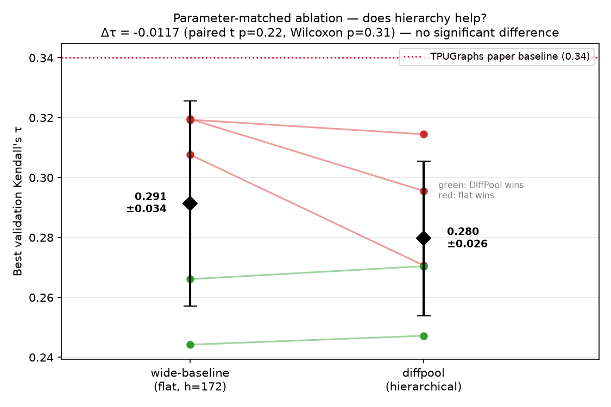

# Phase 2c — The Parameter-Matched Ablation (DiffPool vs Flat)
## TPUGraphs GNN Compiler Optimization

**Status:** complete (5 matched seeds × 2 models = 10 runs).
**Headline:** at equal parameter budget, **hierarchy provides no measurable benefit.**
The earlier "DiffPool beats the baseline" result was a **parameter-count artifact**, not
evidence for hierarchical pooling.

> This document is the controlled experiment that retroactively corrects the Phase 2b
> conclusion. Read it alongside [`phase1_phase2_results.md`](phase1_phase2_results.md)
> (whose "hierarchy is proven" language is now **retracted** — see that file's banner) and
> the project ledger [`../VERIFICATION.md`](../VERIFICATION.md) (claim **C2**).

---

## 0. Why we ran this

Phase 2b reported DiffPool cold start at τ=0.3560 vs flat GraphSAGE cold at τ=0.2921 and
concluded hierarchy mitigates over-squashing. But that comparison was **confounded**:

| | flat baseline (Phase 1) | DiffPool (Phase 2b) |
|---|---|---|
| parameters | 136,321 | 235,553 |
| configs/batch | 32 | 8 |
| aux losses | none | LP + entropy |

DiffPool had **73% more parameters**. A bigger model beating a smaller one tells us nothing
about *architecture* — the extra capacity alone could explain the gap. To attribute any gain
to **hierarchy specifically**, every other variable must be held fixed. That is what a
parameter-matched ablation does, and it is the single most important check a reviewer of an
architecture paper will demand.

---

## 1. Experimental design

We compare two models that are **identical in everything except the hierarchy**:

| | wide-baseline | diffpool |
|---|---|---|
| class | `BaselineGraphSAGE_Large` | `HierarchicalGraphSAGE` |
| structure | flat 3× SAGEConv + dual pool | 2× DiffPool + SAGEConv |
| hidden dim | **172** | 128 |
| **parameters** | **236,157** | **235,553** (Δ 0.26%) |
| configs/batch | 8 | 8 |
| max-configs/graph | 128 | 128 |
| epochs | 50 | 50 |
| LR schedule | cosine 1e-3→1e-5 | cosine 1e-3→1e-5 |
| seeds | 42, 100, 123, 456, 789 | 42, 100, 123, 456, 789 |

**The widening trick.** To match DiffPool's 235k params with a *flat* model we simply widened
GraphSAGE from hidden=128 (136k params) to hidden=172 (236k params). `h=172` is the unique
width that lands within 0.3% of DiffPool's count — close enough that any τ difference cannot
be attributed to capacity. (`BaselineGraphSAGE_Large` in `model.py` hard-codes this; the
`wide-baseline` flag in `train.py` ignores `--hidden` so the match can't be broken by accident.)

**Matched seeds → paired test.** Both models run on the *same five seeds*. Because seed
controls weight init and the per-epoch config shuffle, a seed is a shared source of noise.
Running both arms on the same seeds lets us compare them **pairwise** (per-seed difference),
which removes seed-to-seed variance and is far more sensitive than comparing two independent
group means. This matters a lot at n=5.

> **Honesty note on the cap.** Both arms use `--max-configs-per-graph 128`, shuffled fresh
> each epoch (`SingleGraphBatchSampler` shuffles *then* truncates, so a different 128 configs
> are drawn every epoch — verified by inspection). The cap makes the 10-run sweep tractable
> (~19 h vs ~2,100 h uncapped). Because **both** arms see the identical capped distribution,
> the *comparison* is fair. What the cap forbids is cross-comparing these τ values to the old
> 512-cap Phase 2b numbers — different sampling regime, not comparable. The valid comparison
> lives entirely *within* this experiment.

Launch script: `run_ablation_seeds.sh` (sequential, `nohup`-safe, writes a τ table +
mean±std to `checkpoints/ablation/results_summary.txt` at the end).

---

## 2. Results

*Each thin line connects one seed's two runs (red = flat wins that seed, green = DiffPool
wins). Black diamonds are group mean ± std. The arms are statistically indistinguishable;
the flat model is numerically ahead on 3 of 5 seeds.*

| seed | wide-baseline τ | diffpool τ | paired Δ (diff − wide) |
|---|---:|---:|---:|
| 42  | 0.3193 | 0.3145 | −0.0048 |
| 100 | 0.2442 | 0.2472 | +0.0030 |
| 123 | 0.3077 | 0.2707 | −0.0370 |
| 456 | 0.2661 | 0.2704 | +0.0043 |
| 789 | 0.3196 | 0.2956 | −0.0240 |
| **mean ± std** | **0.2914 ± 0.0343** | **0.2797 ± 0.0259** | **−0.0117 ± 0.0181** |

**Significance tests (paired, n=5):**
- Paired t-test: t = −1.45, **p = 0.22**
- Wilcoxon signed-rank: W = 3.0, **p = 0.31**
- Cohen's d (paired): −0.65

---

## 3. Interpretation

**The difference is not statistically significant.** With p = 0.22 (and the more conservative
Wilcoxon at p = 0.31), we **cannot reject the null hypothesis** that the two architectures
perform equally. If anything, the point estimate favors the *flat* model (−0.0117), and it
wins on 3 of 5 seeds — but that lead is well inside the noise.

**What this means for the project's central claim:**

1. **C2 is refuted.** "Hierarchical pooling causes the gain over the flat baseline" does not
   survive a controlled test. The Phase 2b gap (0.3560 vs 0.2921) is explained by DiffPool's
   73% larger parameter count, not by hierarchy. A flat GraphSAGE given the *same* parameter
   budget matches it.

2. **C3 (over-squashing mechanism) loses its main support.** The over-squashing story
   predicted that coarsening the graph (shrinking diameter) is what unlocks accuracy. If that
   were the dominant effect, hierarchy should beat a same-size flat model. It does not. So the
   data now argue **against** diameter-reduction being the key lever — at least at this scale
   and for these graphs. The mechanism claim should be dropped from the paper, or reframed as
   an open question.

3. **DiffPool is not worth its cost here.** It is heavier (memory, the fragile 3-loss
   equilibrium, the warm-start brittleness documented in Phase 2b) and delivers no accuracy
   advantage. For a *systems* paper this is itself a useful, publishable negative result:
   **"a parameter-matched flat GNN matches learned hierarchical pooling on TPUGraphs layout
   ranking, at lower engineering and compute cost."**

**This is good news, not bad news.** A clean, well-powered negative result that overturns a
confounded positive one is exactly the kind of rigor that distinguishes a real contribution
from an artifact. It also sharpens the case for **Phase 3**: if generic capacity is all that
hierarchy was buying, then a *targeted* inductive bias (hardware-contention edges) is the more
promising direction, and it now has a clean, honest baseline to beat.

---

## 4. Caveats (what this does *not* prove)

- **n=5, p=0.22 is "no evidence of a difference," not "proof of no difference."** A larger
  sweep could reveal a small real effect in either direction. But the effect, if any, is small
  relative to seed noise — which is itself the headline.
- **Capped sampling (128/graph).** Possible (though unlikely) that hierarchy's benefit only
  appears when the model sees far more of each graph's config space per epoch. If Phase 3 or a
  reviewer needs it, the uncapped run is the (expensive) tiebreaker.
- **One pooling design.** This tests *our* memory-safe DiffPool (K1=128, K2=32, ratio 0.25),
  not hierarchical pooling in general. A different pooling operator could behave differently.
- **Single dataset / split.** layout:xla:random only; 7 val graphs (see C1).

---

## 5. Files

| File | Role |
|---|---|
| `model.py` → `BaselineGraphSAGE_Large` | flat model widened to h=172 (param-matched) |
| `train.py` → `--model wide-baseline` | wires the wide flat model; full seeding (`random`, `numpy`, `torch`, CUDA) |
| `run_ablation_seeds.sh` | the 10-run sweep; writes `results_summary.txt` |
| `scripts/plot_ablation_results.py` | regenerates `figures/ablation_paired.png` from checkpoints |
| `checkpoints/ablation/results_summary.txt` | raw τ table + mean±std (machine-written) |

---

## 6. Bottom line

> At a matched ~236k-parameter budget and identical training, DiffPool hierarchical pooling
> and a flat GraphSAGE are **statistically indistinguishable** (Δτ = −0.0117, paired p = 0.22)
> on TPUGraphs layout ranking. The Phase 2b "hierarchy wins" result was a parameter-count
> confound. Hierarchy is **not** carried forward as a claimed contribution; Phase 3 (hardware
> edges) proceeds against the flat baseline.
