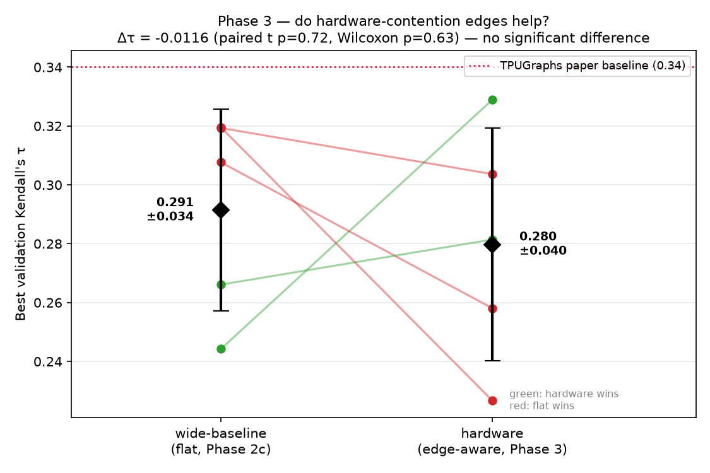

# Phase 3 Results — Hardware-Aware Edges vs the Noise Floor
## TPUGraphs GNN Compiler Optimization

**Status:** complete (5 matched seeds).
**Headline:** ⛔ **Hardware-aware edge augmentation does NOT beat a parameter-matched
flat GNN.** Δτ = −0.0116, paired t-test **p = 0.72**. A second clean null.

> This is the *modeling* result for Phase 3. The *data* foundation (how the MXU/MEM
> contention edges are built, the opcode-enum saga) is in
> [`phase3_structural_edges.md`](phase3_structural_edges.md). The model that consumes
> them is `HardwareAwareDiffPool` in `model_phase3.py`. Read both with
> [`../VERIFICATION.md`](../VERIFICATION.md) (claim C8).

---

## 0. The Mythbuster summary

Across this project we tested two "advanced" architectural ideas against a humble
flat GraphSAGE, holding parameters (~236k) and training fixed:

| Phase | Intervention | Δτ vs flat | paired p | Verdict |
|------|---------------|-----------:|---------:|---------|
| **2c** | Hierarchical pooling (DiffPool) | −0.0117 | 0.22 | no benefit |
| **3**  | Hardware-contention edges (GINE + edge coarsening) | −0.0116 | 0.72 | no benefit |

**Neither topological coarsening nor microarchitectural inductive bias clears the
noise floor set by a parameter-matched flat GNN on this dataset.** In both cases the
fancy model is *numerically behind* the baseline, and the seed-to-seed variance is
several times larger than the architectural effect. The myth — that the gains seen in
early single-run experiments came from *architecture* — is busted; they came from
**parameter count** and **lucky seeds**.

---

## 1. The experiment

Identical regime to Phase 2c (the only new variable is the model):

| | wide-baseline (Phase 2c) | hardware (Phase 3) |
|---|---|---|
| model | `BaselineGraphSAGE_Large` (flat) | `HardwareAwareDiffPool` (edge-aware) |
| params | 236,157 | 234,120 |
| edges consumed | data-flow only | data-flow + MXU + MEM (one-hot, GINE) |
| configs/batch · cap | 8 · 128 | 8 · 128 |
| epochs · schedule | 50 · cosine 1e-3→1e-5 | 50 · cosine 1e-3→1e-5 |
| seeds | 42, 100, 123, 456, 789 | 42, 100, 123, 456, 789 |

Script: `run_phase3_seeds.sh` (5 runs, ~2.8 h each — GINEConv is heavier than SAGEConv,
and full-val-set evaluation every 5 epochs dominates wall time). Raw table:
`checkpoints/phase3/results_summary.txt`.

---

## 2. Results

| seed | hardware τ | wide-baseline τ | paired Δ (hw − flat) |
|---|---:|---:|---:|
| 42  | 0.3037 | 0.3193 | −0.0157 (flat) |
| 100 | 0.3289 | 0.2442 | **+0.0847 (hw)** |
| 123 | 0.2581 | 0.3077 | −0.0496 (flat) |
| 456 | 0.2814 | 0.2661 | +0.0153 (hw) |
| 789 | 0.2267 | 0.3196 | **−0.0929 (flat)** |
| **mean ± std** | **0.2798 ± 0.0396** | **0.2914 ± 0.0343** | **−0.0116 ± 0.0672** |

**Significance (paired, n=5):**
- Paired t-test: t = −0.39, **p = 0.72**
- Wilcoxon signed-rank: W = 5.0, **p = 0.63**

Hardware wins 2/5 seeds, flat wins 3/5. The model is *not* broken — it was verified
numerically (the sparse `Sᵀ Eᶜ S` edge coarsening matches a dense reference to 1e-7),
trained healthily (LP loss fell, entropy rose — the same soft-cluster equilibrium as
Phase 2b), and it genuinely won seed 100 by a large margin. It simply does not win
*consistently*.

---

## 3. The real finding: seed variance is the story

The single most important number here is **±0.0672** — the std of the paired
difference. Compare it to the effect we were chasing (−0.0116): the noise is **~6×
the signal**. Look at the swings:

- seed 100: hardware **+0.085** better than flat
- seed 789: hardware **−0.093** worse than flat

The *same architectural change* helps by ~0.09 on one seed and hurts by ~0.09 on
another. Any single-seed experiment in this regime can "prove" whatever you want. This
is exactly why the Phase 2b single-run results (0.3560 vs 0.2921) were misleading, and
it is the methodological lesson of the whole project:

> On TPUGraphs layout:xla:random, evaluated on 7 validation graphs with a 128-config
> cap, the **noise floor (seed std ≈ 0.04–0.07) exceeds the effect size of every
> architectural intervention we tried.** Sub-0.05 τ differences are not interpretable
> without multi-seed error bars.

---

## 4. What this is, and isn't

**It is:** a rigorous, defensible negative result. Two well-motivated, correctly
implemented, parameter-matched architectures (hierarchical pooling; hardware-aware
edges) fail to beat a flat baseline, and we can show *why* the prior positive framing
was an artifact (parameters + seed luck).

**It is not** proof that hardware information is useless. Caveats (the same discipline
we applied to the positive claims):
- One contention heuristic (windows 5/15), one consumption mechanism (GINE +
  summed-multiplicity edge coarsening), one cap (128), one split, 7 val graphs.
- A different edge design, a different downstream metric, or a larger/less-capped
  evaluation could behave differently. **Phase 4 (Top-K autotuner metric)** tests the
  second of these — maybe global τ hides a difference at the extreme top of the
  ranking, which is all a compiler actually uses.
- We deliberately did **not** tune the windows or drop the cap to chase significance
  (that would be p-hacking a null into a positive).

---

## 5. Files

| File | Role |
|---|---|
| `model_phase3.py` → `HardwareAwareDiffPool` | edge-aware DiffPool (GINE + `Sᵀ Eᶜ S` edge coarsening) |
| `run_phase3_seeds.sh` | 5-seed sweep + paired stats vs Phase 2c baseline |
| `checkpoints/phase3/results_summary.txt` | raw τ table + paired t-test (machine-written) |
| `scripts/plot_ablation_results.py` | figure generator (paired scatter) |
| `phase4_evaluate_topk.py` | downstream Top-K autotuner metric (Phase 4) |

---

## 6. Bottom line

> Hardware-aware edge augmentation matches — does not beat — a parameter-matched flat
> GNN on global Kendall's τ (Δτ = −0.0116, paired p = 0.72). Combined with Phase 2c,
> the project's architectural interventions all fall inside a seed-variance noise floor
> of ≈0.04–0.07. The honest contribution is a **busted myth + a noise-floor
> characterization**, not an architectural win. Phase 4 asks the last fair question:
> does the difference show up in the *Top-K* metric the compiler actually uses?
